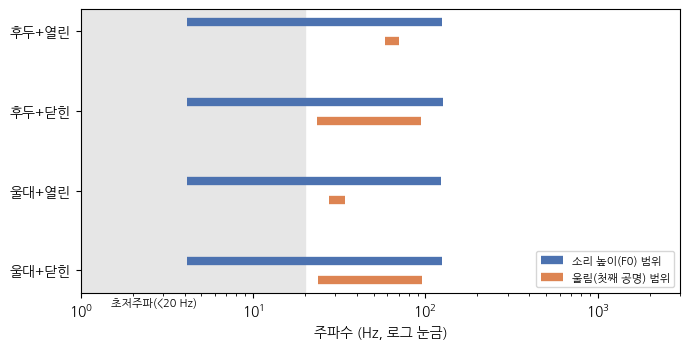
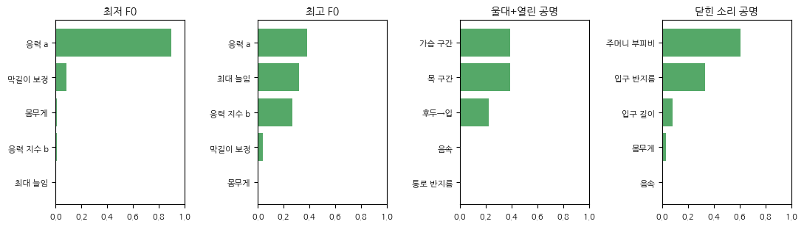
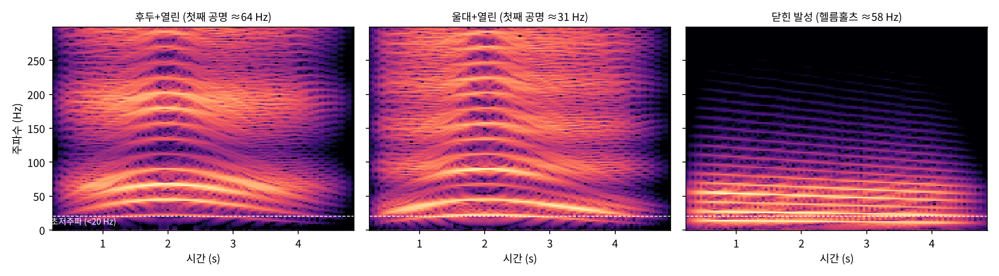

# trex_vocal — 음원-필터 모델로 본 티라노사우루스의 발성 범위 추정

티라노사우루스(*Tyrannosaurus rex*)가 낼 수 있었던 소리의 범위를 **음원-필터 모델**로 계산합니다.
화석에 남지 않은 미지수는 문헌에 근거한 확률분포로 두고 **몬테카를로 시뮬레이션**으로 범위를 구합니다.
그 뒤 **Sobol 민감도 분석**으로 어떤 미지수가 범위의 폭을 가장 크게 흔드는지 밝힙니다.

> 글쓰기 수업 연구 보고서 「음원-필터 모델로 본 티라노사우루스(Tyrannosaurus rex)의 발성 범위 추정」(이채령, 고려대학교 컴퓨터학과, 2026)의 코드와 자료입니다.

## 저장소 구성

```
trex_vocal/
├── trex_vocal_sim.ipynb        # Openwind 검증 + 몬테카를로 + Sobol 민감도 분석 (보고서 표 1·2, 그림 1·2)
├── sound/
│   ├── trex_voice.py           # 대표값으로 소리를 합성하는 스크립트 (보고서 부록 B)
│   ├── trex_larynx_open_original.wav     # 후두 + 열린 발성 (물리 스케일)
│   ├── trex_larynx_open_listen_x4.wav    # 후두 + 열린 발성 (청취용, 주파수 ×4)
│   ├── trex_syrinx_open_original.wav     # 울대 + 열린 발성 (물리 스케일)
│   ├── trex_syrinx_open_listen_x4.wav    # 울대 + 열린 발성 (청취용, 주파수 ×4)
│   ├── trex_closed_original.wav          # 닫힌 발성 (물리 스케일)
│   └── trex_closed_listen_x4.wav         # 닫힌 발성 (청취용, 주파수 ×4)
└── figures/
    ├── fig1_ranges.png         # 그림 1: 네 조합의 F0와 첫째 공명 범위
    ├── fig2_sobol.png          # 그림 2: 출력별 Sobol 총효과 지수(ST)
    └── fig3_spectrogram.png    # 그림 B-1: 합성한 소리의 스펙트로그램
```

## 모델 요약

| 구성 | 식 | 설명 |
|---|---|---|
| 음원(F0) | F0 = 1 / (2L(1+ε)) · √(σ/ρ),  σ = a·e^(bε) | 막을 진동하는 줄로 근사. L = 3.28·M^0.4 mm × 보정 배수 |
| 열린 발성 | F = κ · c / 4(L + 0.61r) | 한쪽이 막힌 관의 첫째 공명(열린 끝 보정 포함). κ는 Openwind 수치 실험에서 얻은 공식 오차 |
| 닫힌 발성 | F = c / 2π · √(A / (V·L_eff)),  L_eff = l + 1.7r | 부푼 주머니의 헬름홀츠 공명 |

- **음원 2가지:** 후두(통로 = 후두→입)와 울대(통로 = 후두→입 + 목 구간 기관 + 가슴 구간 기관)
- **입 모양 2가지:** 열린 발성과 닫힌 발성
- 두 가지를 곱해 **네 가지 발성 조합**이 되고, 조합마다 50,000회를 계산합니다.
- **거름 기준:** 표본은 두 조건을 모두 만족할 때만 남깁니다.
  - 소리가 청각 범위 10–3,000 Hz와 겹칠 것
  - 최저 F0가 몸무게로 예측한 값(450·M^−0.38)의 1/4–4배 안에 들 것

모든 변수의 범위와 근거는 노트북의 `[1] 매개변수` 칸과 보고서 표 1에 있습니다.

### 통로 공식 검증 (Openwind)

노트북 `[2]` 칸은 관악기 음향 시뮬레이터 [Openwind](https://openwind.inria.fr)로 18개 원통관(길이 1.2–3.4 m × 반지름 3, 5.5, 8 cm, 36.3℃)의 첫째 공명을 계산합니다. 이 값은 관 벽의 점성·열 손실과 열린 끝의 방사를 포함합니다.

- 단순 공식 c/4L 대비: Openwind/공식 = 0.980 ± 0.008 (최대 차이 3.8%)
- 끝 보정 공식 c/4(L+0.61r) 대비: 0.998 ± 0.003

그래서 시뮬레이션에는 끝 보정 공식을 쓰고, 이 비율을 오차 항 κ ~ N(0.998, 0.003)으로 곱합니다. Openwind를 설치할 수 없는 환경에서는 이 값을 그대로 씁니다.

## 실행 방법

1. [Google Colab](https://colab.research.google.com/)에서 `trex_vocal_sim.ipynb`를 엽니다. GitHub 탭에 `dlcofud/trex_vocal`을 입력하면 됩니다.
2. **런타임 → 모두 실행**을 누릅니다. 첫 실행 때 `SALib`, `openwind`, 한글 글꼴(나눔)이 자동으로 설치됩니다. 전체 실행은 몇 분 걸립니다.
3. 실행하면 다음 파일이 만들어집니다.
   - `result_openwind.csv`: 18개 관의 Openwind·공식 공명 비교 (보고서 표 2)
   - `result_ranges.csv`: 네 조합의 5–50–95 백분위 범위
   - `result_sobol.csv`: Sobol S1·ST 지수와 95% 신뢰구간 반폭
   - `fig1_ranges.png`, `fig2_sobol.png`: 보고서 그림 1·2

로컬에서 실행하려면 다음을 설치하세요.

```bash
pip install numpy scipy pandas matplotlib SALib openwind
```

### 재현성

- **난수 시드:** 몬테카를로는 `np.random.default_rng(2026)`, Sobol 표본 추출과 분석은 `seed=1`로 고정했습니다.
- **Sobol 표본:** 기준 표본은 N = 4,096이고 `calc_second_order=True`가 기본값입니다. 총 계산 횟수는 N×(2D+2)입니다.
  - 변수가 5개인 출력(D = 5): 49,152회
  - 변수가 4개인 출력(D = 4): 40,960회
- **수렴 확인:** 노트북 `[6]` 칸에서 표본 수를 25,000회로 줄여 다시 계산합니다.
  - 모든 5–50–95 백분위 값의 변화는 최대 2.0%였습니다.
  - Sobol ST의 95% 신뢰구간 반폭(`ST_conf`)은 최대 0.032였습니다.
- **실행 환경:** 노트북 `[0]` 칸이 실행할 때마다 버전을 출력합니다. 저장된 결과는 2026-11-19에 Python 3.13.18, NumPy 2.5.3, SciPy 1.18.1, pandas 3.0.5, SALib 1.6.0, Openwind 0.12.4에서 실행한 것입니다.

## 주요 결과

| 조합 | 최저 F0 (Hz) | 최고 F0 (Hz) | 첫째 공명 (Hz) |
|---|---|---|---|
| 후두 + 열린 | 4.1–15.3 | 13.5–125.4 | 58.0–70.7 |
| 후두 + 닫힌 | 4.1–15.4 | 13.5–125.9 | 23.6–94.3 |
| 울대 + 열린 | 4.1–15.4 | 13.3–122.8 | 27.6–34.3 |
| 울대 + 닫힌 | 4.1–15.2 | 13.4–124.7 | 23.7–95.3 |

*값은 거름을 통과한 표본(약 85%)의 5–95 백분위입니다. 이 저장소의 노트북을 2026-11-19에 실행한 결과입니다.*

- **최저 F0:** 95% 이상의 표본에서 사람의 가청 하한 20 Hz보다 낮습니다. 곧 초저주파 영역입니다.
- **최저 F0 분산의 약 90%는 응력 상수 a에서 나옵니다(ST = 0.90).** 몸무게의 기여는 약 1%입니다.
- **울대 + 열린 발성 공명:** 목 구간 기관(ST = 0.39)과 가슴 구간 기관(ST = 0.39)이 지배합니다. 통로 반지름은 0.002에 그칩니다.
- **닫힌 발성 공명:** 주머니 부피비(ST = 0.61)와 입구 반지름(ST = 0.33)이 지배합니다.




## 합성한 소리 (보고서 부록 B)

표 1 범위의 대표값으로 각 조합의 소리를 하나씩 합성했습니다. 대표값은 다음과 같습니다.

- 몸무게 7,750 kg
- 응력 상수 a = 1.53 kPa (로그정규 분포의 중앙값)
- b = 16.2
- 최대 늘임 25%
- 통로: 후두→입 1.35 m, 목 1.2 m, 가슴 0.3 m, 반지름 5.5 cm
- 주머니: 몸 부피의 0.32%, 입구 반지름 4 cm, 입구 길이 12.5 cm

| 조합 | F0 범위 | 첫째 공명 | 물리 스케일 | 청취용 (×4) |
|---|---|---|---|---|
| 후두 + 열린 | 6.4–31.2 Hz | 64 Hz | [원본](sound/trex_larynx_open_original.wav) | [청취용](sound/trex_larynx_open_listen_x4.wav) |
| 울대 + 열린 | 6.4–31.2 Hz | 31 Hz | [원본](sound/trex_syrinx_open_original.wav) | [청취용](sound/trex_syrinx_open_listen_x4.wav) |
| 닫힌 발성 | 6.4–31.2 Hz | 58 Hz (헬름홀츠) | [원본](sound/trex_closed_original.wav) | [청취용](sound/trex_closed_listen_x4.wav) |

- **두 가지 버전:** 물리 스케일 원본은 에너지 대부분이 20–70 Hz에 있어 일반 스피커로는 거의 들리지 않습니다. 그래서 모든 주파수를 정확히 4배(2옥타브) 올려 다시 합성한 **청취용** 파일을 함께 두었습니다. 청취용 파일은 공명 구조는 같지만 실제 소리 높이가 아닙니다.
- **닫힌 발성은 한 파일:** 이 모델에서는 후두형과 울대형이 같은 소리를 냅니다. 닫힌 발성의 공명 공식에 통로 길이가 들어가지 않기 때문입니다.
- **합성 방식:**
  - 음원: Rosenberg 성문 펄스열
  - 열린 발성 필터: 홀수 배 공명(F1, 3F1, 5F1 …)을 가진 관 + 입 방사
  - 닫힌 발성 필터: 헬름홀츠 공명기 + 몸통을 통한 저역 통과
- **연출값:** 소리 높이의 오르내림, 지터(약 2%), 쉬머(약 8%), 기류 잡음은 보고서 변수가 아닙니다. 소리를 자연스럽게 들리게 하려고 정한 값입니다.
- 이 소리는 범위 안의 대표 표본 하나일 뿐, 티라노사우루스의 '정답 소리'가 아닙니다.

다시 합성하려면 `sound/` 폴더에서 다음을 실행합니다. 대표값은 스크립트 상단에서 바꿀 수 있습니다.

```bash
cd sound
python trex_voice.py
```



## 한계

- 조직 성질은 악어(Riede 외, 2015)의 값을, 막 길이는 포유류 회귀식(Titze 외, 2016)을 빌렸습니다.
- 닫힌 발성의 변수는 근거가 없어 넓게 가정했습니다.
- 음원과 통로를 독립으로 계산하므로 음원–필터 상호작용을 반영하지 않습니다. 울대 + 열린 조합에서는 공명이 F0 범위와 겹친 표본이 67%로, 이 오차가 가장 클 수 있습니다.
- 닫힌 발성에서 기관과 주머니의 결합을 다루지 않습니다.

## 주요 참고문헌

- Herman, J., Usher, W. (2017). SALib: An open-source Python library for sensitivity analysis. *Journal of Open Source Software* 2(9), 97.
- Hutchinson, J. R. 외 (2011). A computational analysis of limb and body dimensions in *Tyrannosaurus rex*. *PLoS ONE* 6(10), e26037.
- Riede, T. 외 (2015). Functional morphology of the *Alligator mississippiensis* larynx with implications for vocal production. *Journal of Experimental Biology* 218(7), 991–998.
- Riede, T. 외 (2019). The evolution of the syrinx: An acoustic theory. *PLoS Biology* 17(2), e2006507.
- Titze, I. R. 외 (2016). Predicting achievable fundamental frequency ranges in vocalization across species. *PLoS Computational Biology* 12(6), e1004907.

전체 참고문헌은 보고서를 참고하세요.

---

코드 작성, 소리 합성, 선행 연구 검색에 생성형 AI(Anthropic Claude Opus 5.5)의 도움을 받았습니다.
